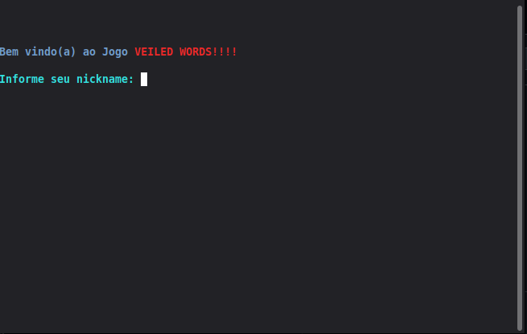
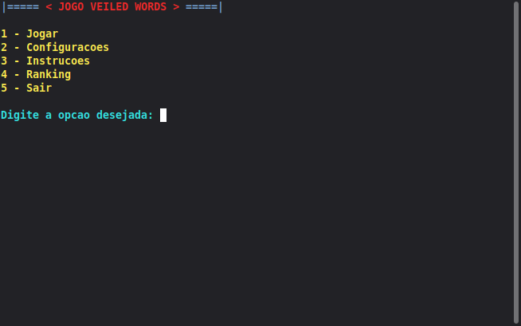
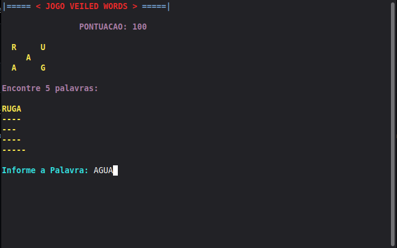

<a id="pt"></a>

<p align="center">
  <strong>🌐 Navegação:</strong>
  <a href="#pt">PT</a> | <a href="#en">EN</a>
</p>

<p align="center">
  
  
  
</p>

# 🎮 Projeto APC — **(VEILED WORDS)**

Este projeto consiste em um jogo desenvolvido em **C**, originalmente criado no **Linux (Linux Mint)**, e totalmente compatível com **Windows** e **Linux**.

O objetivo deste README é fornecer instruções claras para compilar e executar corretamente o jogo, bem como prevenir problemas comuns relacionados à leitura de arquivos e à exibição de cores no terminal.

---

## 🖼️ Screenshots


<p align="center">
  
</p>
<br></br>
<p align="center">
  
</p>
<br></br>
<p align="center">
  
</p>

---

## 📦 Requisitos

* Compilador C (GCC ou equivalente)
* Sistema operacional:

  * Linux (recomendado)
  * Windows 10 ou superior
* Editor/IDE (opcional, mas recomendado):

  * Visual Studio Code

---

## ▶️ Como Compilar e Executar

### 🔹 No Linux (Recomendado)

```bash
gcc projeto.c -o jogo
./jogo
```

> 💡 No Linux, o jogo lida corretamente com diretórios relativos, evitando problemas com arquivos externos.

---

### 🔹 No Windows (VS Code)

Se você estiver utilizando o **Visual Studio Code** com as seguintes extensões:

* **C/C++ (Microsoft)**
* **C/C++ Compile Run (danielpinto8zz6)**

E executar o jogo pressionando **F6** ou pelo botão **Run**, pode ocorrer o seguinte erro:

```
Arquivo não existe, ou não foi encontrado!
```

---

## ⚠️ Problema Comum no VS Code (Windows)

### ❌ Motivo

A extensão **C/C++ Compile Run** cria automaticamente uma pasta denominada `output` e gera o executável (`.exe`) dentro dela.
Como o arquivo `entrada.txt` permanece na pasta raiz do projeto, o executável não consegue localizá-lo.

---

### ✅ Solução Rápida

1. Localize a pasta `output` criada na raiz do projeto.
2. Copie (ou arraste) o arquivo `entrada.txt` para dentro dessa pasta `output`.
3. Execute o jogo novamente.

---

## 🎨 Suporte a Cores no Terminal

O jogo possui suporte a **cores ANSI** no terminal.

### 🔹 Compatibilidade

* ✔ Linux
* ✔ Windows 10 ou superior
* ❌ Versões mais antigas do Windows podem não exibir cores corretamente.

---

### 🔗 Referências sobre códigos ANSI

* [https://en.wikipedia.org/wiki/ANSI_escape_code#Colors](https://en.wikipedia.org/wiki/ANSI_escape_code#Colors)
* [https://pt.stackoverflow.com/questions/341436/como-mudar-a-cor-de-uma-linha-do-console-em-c](https://pt.stackoverflow.com/questions/341436/como-mudar-a-cor-de-uma-linha-do-console-em-c)

---

## 📌 Observações Finais

* Para evitar qualquer problema com diretórios e leitura de arquivos, **recomenda-se executar o jogo no Linux**.
* Certifique-se de que o arquivo `entrada.txt` esteja sempre no mesmo diretório do executável.

---

## 🎓 Sobre o Projeto

Projeto desenvolvido para a disciplina **APC**, ministrada por **Carla Castanho**, na **Universidade de Brasília (UnB)**.

---
<br> </br>

<a id="en"></a>

<p align="center">
  <strong>🌐 Navigation:</strong>
  <a href="#pt">PT</a> | <a href="#en">EN</a>
</p>

<p align="center">
  
  
  
</p>

# 🎮 APC Project — **(VEILED WORDS)** 

This project is a game developed in **C**, originally created on **Linux (Linux Mint)**, and fully compatible with **Windows** and **Linux**.

The purpose of this README is to provide clear instructions on how to compile and run the game correctly, as well as to prevent common issues related to file reading and terminal color display.

---

## 🖼️ Screenshots

<p align="center">
  
</p>
<br></br>
<p align="center">
  
</p>
<br></br>
<p align="center">
  
</p>

---

## 📦 Requirements

* C compiler (GCC or equivalent)
* Operating system:

  * Linux (recommended)
  * Windows 10 or later
* Editor/IDE (optional, but recommended):

  * Visual Studio Code

---

## ▶️ How to Compile and Run

### 🔹 On Linux (Recommended)

```bash
gcc projeto.c -o game
./game
```

> 💡 On Linux, the game correctly handles relative directories, avoiding issues with external files.

---

### 🔹 On Windows (VS Code)

If you are using **Visual Studio Code** with the following extensions:

* **C/C++ (Microsoft)**
* **C/C++ Compile Run (danielpinto8zz6)**

And you run the game by pressing **F6** or clicking the **Run** button, you may encounter the following error:

```
"Arquivo não existe, ou não foi encontrado!" ==  "File does not exist or was not found!"
```

---

## ⚠️ Common Issue in VS Code (Windows)

### ❌ Reason

The **C/C++ Compile Run** extension automatically creates a folder named `output` and generates the executable (`.exe`) inside it.
Since the file `entrada.txt` remains in the project root folder, the executable cannot locate it.

---

### ✅ Quick Fix

1. Locate the `output` folder created in the project root.
2. Copy (or drag) the file `entrada.txt` into the `output` folder.
3. Run the game again.

---

## 🎨 Terminal Color Support

The game supports **ANSI colors** in the terminal.

### 🔹 Compatibility

* ✔ Linux
* ✔ Windows 10 or later
* ❌ Older Windows versions may not display colors correctly.

---

### 🔗 ANSI Color References

* [https://en.wikipedia.org/wiki/ANSI_escape_code#Colors](https://en.wikipedia.org/wiki/ANSI_escape_code#Colors)
* [https://pt.stackoverflow.com/questions/341436/como-mudar-a-cor-de-uma-linha-do-console-em-c](https://pt.stackoverflow.com/questions/341436/como-mudar-a-cor-de-uma-linha-do-console-em-c)

---

## 📌 Final Notes

* To avoid any directory or file-reading issues, **running the game on Linux is recommended**.
* Make sure the file `entrada.txt` is always in the same directory as the executable.

---

## 🎓 About the Project

Project developed for the **APC** course, taught by **Carla Castanho**, at the **University of Brasília (UnB)**.


